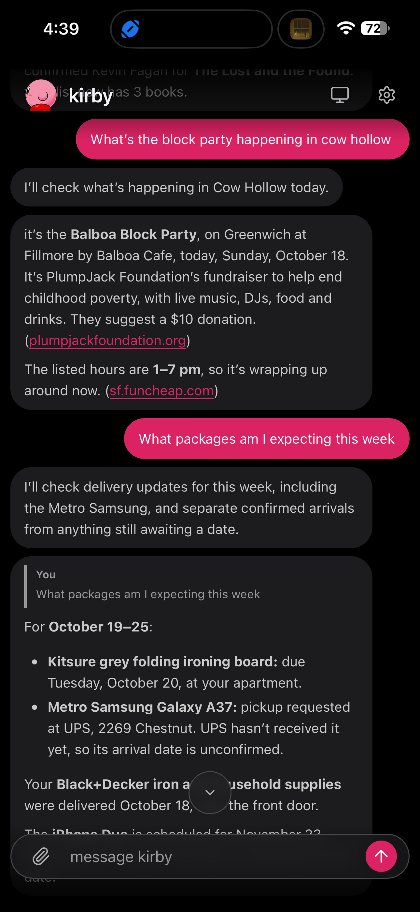

# Pal

Personal assistant backend with NestJS, PostgreSQL, local file storage, and live chat updates.

> [!WARNING]
> Pal is Tailscale-only. Do not expose it to the public internet.

  

- [Backend setup](backend/README.md)
- [React PWA](frontend/README.md)
- [Full-stack local development](backend/README.md#full-stack-local-development)
- [Frontend playground](frontend-playground/README.md)
- [Architecture and API](architecture/backend.md)
- [Implementation plans](plans/index.md)
